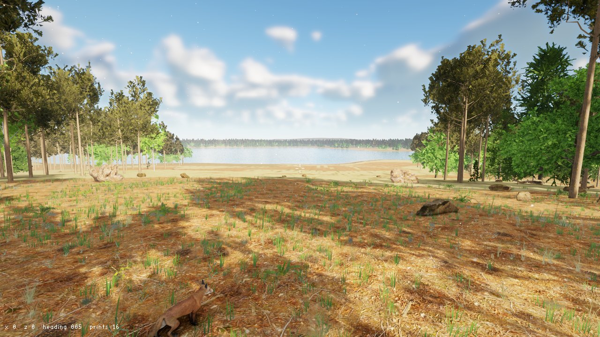

# Poligon



*`forest_scene` in the `high` preset at 1920 x 1080 (shown smaller). Fox: Khronos glTF sample "Fox" (model CC0, animations CC-BY 4.0); other models and textures from Poly Haven (CC0) and made by code.*

Poligon is a C++ game engine for Windows, written for open-world games: large terrain, forests,
water, animated animals, a player walking in first person. It is assembled from proven
libraries (SDL3 GPU for the window and rendering, Jolt Physics, flecs, ozz-animation, Assimp,
Dear ImGui) with our own renderer, terrain generator, vegetation and world streaming on top.
A game is written in code against the engine; there is no editor yet. "Poligon" is Polish for
a proving ground.

It is built for work with an AI coding agent, and most of its own code is a verification
layer that lets the agent find out by itself whether a change works: headless runs with a
fixed time step, PNG frame dumps compared with a tolerance, JSON dumps of the game state,
input recording with deterministic replay (two replays give an identical state), crash
reports with call stacks, and one small runnable example per engine feature. Every change
is checked by one script that builds and tests three configurations (Debug,
AddressSanitizer, static analysis); the rendering tests run on both Direct3D 12 and Vulkan.

## Requirements

- Windows 10 or 11, x64.
- A graphics card with Direct3D 12 or Vulkan 1.3. The target
  for the `medium` preset is a GeForce GTX 980 (4 GB) at 1920 x 1080 and 60 frames per second.
  No ray tracing or mesh shaders are used.
- Visual Studio 2022 or Build Tools for Visual Studio 2022 with the workload "Desktop
  development with C++", including the components "MSVC x64/x86 build tools", "C++ CMake
  tools for Windows" (CMake and Ninja) and "vcpkg package manager".
- Git (vcpkg needs it), and an internet connection on the first build (vcpkg downloads the
  libraries).
- About 8 GB of free disk space for the build folders, plus the vcpkg cache in the user profile.

## Building from a clean clone

1. Clone the repository and open PowerShell in its folder:
   ```
   git clone <repository URL> poligon
   cd poligon
   ```
2. Build and test everything:
   ```
   powershell -ExecutionPolicy Bypass -File tools\check.ps1
   ```
   The script finds Visual Studio through `vswhere`, loads its x64 environment into its own
   process (nothing on the system is changed), uses the vcpkg copy bundled with Visual Studio
   in manifest mode (`vcpkg.json`, with the package catalog pinned to one commit), and then
   configures, builds and tests the presets `dev` (Debug), `asan` (AddressSanitizer) and
   `analyze` (MSVC static analysis). The last line `CHECK PASSED` means success.
   A full run from a clean clone took 19.6 minutes on the author's machine (12 logical processors), with
   the libraries taken from vcpkg's binary cache in the user profile; on a machine without
   that cache vcpkg builds them first, which adds time that was not measured. One preset is
   quicker: `tools\check.ps1 -Presets dev`.
3. For an optimized build (to measure speed or to look at the scenes):
   ```
   . tools\dev_env.ps1
   cmake --preset release
   cmake --build --preset release
   ```

All programs and DLLs land in `build\<preset>\bin\`. More in [docs/en/building.md](docs/en/building.md).

## Examples and tests

Every engine feature has a small example in `examples\<area>\` (for instance
`examples\core\game_loop`, `examples\render\renderer`, `examples\physics\physics`); they are
built as `example_<name>.exe` and run as tests. To run the tests of one preset after a build:

```
. tools\dev_env.ps1
ctest --preset dev
```

One example by hand: `build\dev\bin\example_renderer.exe`. The toy game:
`build\dev\bin\toy.exe` (with a window) or
`build\dev\bin\toy.exe --headless --ticks 600 --dump-frame frame.png` (without one; standard
options in [docs/en/game_loop.md](docs/en/game_loop.md)).

## forest_scene and its assets

`forest_scene` is the showcase: 6 x 6 km of land made by the engine's terrain generator, a
forest above a lake, a fox, water, clouds and a day sky. It needs models and textures that are
not in this repository. Two ways to get them:

- **The asset archive of a release** (`poligon-0.1.0-assets.zip`): unzip it so that the folder
  `poligon-assets` lies next to the program's folder or next to the project folder (the program
  looks for `poligon-assets` in every folder above itself). It holds the cooked assets in one
  archive, and `ATTRIBUTION.md` with the author, source and license of each.
- **Your own copies of the sources**: put them in `poligon-assets\source` next to the project
  folder; `forest_scene` cooks them into `poligon-assets\cooked` when it starts. The list of
  what it needs and from where is `tools\forest_scene\assets.txt`; the sources and licenses
  are in `ATTRIBUTION.md` of the asset archive.

Then run `build\release\bin\forest_scene.exe`. Keys: W/S/A/D walk, Shift runs, Space jumps,
the left mouse button held looks around, F flies, Tab hides the debug windows, `--quality
low|medium|high|ultra` chooses the graphics preset. The first start generates and cooks the land
(a few minutes) when it is not in the asset archive.

## State and what is missing

Version 0.1.0 is the first release. Done: the verification layer, model import, a renderer
with cascaded shadows, physically based materials, a physical sky with time of day, volumetric
clouds and fog, temporal anti-aliasing with upscaling, XeGTAO ambient occlusion, AgX tone
mapping and four graphics presets; skeletal animation; physics; a terrain generator with
erosion and water maps; streamed land; instanced vegetation with impostors, plants placed by
rules, grass made by code; water surfaces; an asset cooker with block-compressed textures and
archives; debug windows.

Not there yet: a user interface for games (menus, HUD beyond debug text), sound, navigation
for animals, scripting, FSR 2 upscaling, a level editor, saving and loading games. The engine
is for its author for now; the API may change between versions.

## License

MIT, see [LICENSE](LICENSE). Libraries and code of others built into the engine, with their
licenses: [THIRD_PARTY_LICENSES.md](THIRD_PARTY_LICENSES.md).

## Documentation

[docs/en](docs/en) (also in Polish in [docs/pl](docs/pl)). [CLAUDE.md](CLAUDE.md) is the rule
book and table of contents for the AI agent that works on the engine.

Polish version of this file: [README.pl.md](README.pl.md).
